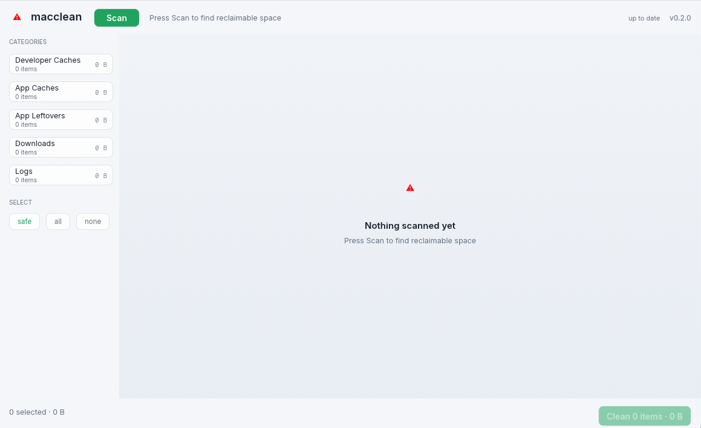

# macclean

A safe, fast macOS disk cleaner written in Rust. Finds reclaimable disk space and
deletes it through the Trash — never `rm`, always recoverable.
[Download page →](https://ranb27.github.io/macclean)

   [](https://github.com/ranb27/macclean/actions/workflows/ci.yml)

<picture>
  <source media="(prefers-color-scheme: dark)" srcset="assets/screenshot-dark.png">
  <source media="(prefers-color-scheme: light)" srcset="assets/screenshot-light.png">
  
</picture>

## Why another cleaner?

Existing tools either delete aggressively (risking your data) or hide their rules
behind a paywall. macclean is built around one principle: **only offer what can be
regenerated, and make deletion reversible.**

- **Move to Trash, not `rm`** — every deletion goes through `NSFileManager`, so
  Finder's *Put Back* restores it.
- **Safety levels** — `safe` targets are 100% regenerable (caches, derived data,
  logs). `review` targets need your judgement (data of uninstalled apps).
- **Never touches** documents, session data, cookies, `IndexedDB`, `LocalStorage`,
  keychains, or anything under `/System`.
- **Dry-run by design** — nothing is deleted until you tick boxes and press the
  button.

## What it scans

| Category | Examples |
|---|---|
| Developer caches | `npm`, `bun`, `pnpm`, `yarn`, `uv`, `pip`, Go modules, Cargo, Gradle, Maven, Deno, Xcode `DerivedData` |
| Developer data (review) | `CoreSimulator/Devices`, Xcode `Archives`, `iOS DeviceSupport` |
| Cleanup commands | `brew cleanup -s`, `xcrun simctl delete unavailable` — run the tool's own cleanup instead of deleting files |
| App caches | `~/Library/Caches/*`, `Application Support/<app>/{Cache, Code Cache, GPUCache, Service Worker, …}` — installed apps only |
| App leftovers | Data dirs whose owning `.app` no longer exists (bundle-ID matching across `Application Support`, `Containers`, `Group Containers`, `HTTPStorages`, `Saved Application State`, `LaunchAgents`, `Preferences`) |
| Downloads | `.dmg`/`.pkg` installers left in `~/Downloads` |
| Logs | `~/Library/Logs/*`, Homebrew service logs (truncated in place so daemons keep their file handle) |

The leftover detector is the interesting part: it reads `Info.plist` of every
installed `.app` and flags Library entries that match no bundle ID or app name —
the same orphans CleanMyMac charges you to find.

## Install & run

**Prebuilt app** (Apple Silicon, macOS 11+): download
[macclean-macos-arm64.dmg](https://github.com/ranb27/macclean/releases/latest/download/macclean-macos-arm64.dmg),
open it, drag `macclean` to Applications.

Unsigned — the first launch needs right-click → **Open** (once), or
`xattr -d com.apple.quarantine /Applications/macclean.app`.

**From source:**

```sh
git clone https://github.com/ranb27/macclean
cd macclean
cargo run --release
```

Requires macOS + a Rust toolchain (`rustup` or `brew install rust`).

## AI integration (MCP)

`macclean --mcp` runs a Model Context Protocol server over stdio, so an AI
assistant can inspect and clean your Mac through the same safety rules the
GUI uses.

**Easiest setup:** click **Connect AI** in the app's toolbar — it detects
installed clients and wires them in one click: Claude (Desktop config +
`claude mcp add`), OpenAI Codex (`config.toml`), and Google Gemini
(`settings.json`). Devin is org-managed, so it and any other client get a
copy-snippet instead. A **Test connection** button runs the MCP handshake
against the server to confirm it answers.

Or point your MCP client at the installed app manually:

```json
{
  "mcpServers": {
    "macclean": {
      "command": "/Applications/macclean.app/Contents/MacOS/macclean",
      "args": ["--mcp"]
    }
  }
}
```

Tools: `disk_summary`, `scan_targets`, `clean_targets`. The clean tool is
whitelist-by-construction — it re-scans and only acts on paths the scan
currently reports as `safe` (regenerable). `review` targets and arbitrary
paths are always skipped; nothing else can be deleted through MCP.

## How it works

```
scan (background thread)
  ├── DEV_CACHE_PATHS    fixed list of known-regenerable tool caches
  ├── commands           whitelisted cleanups: brew cleanup, simctl delete
  ├── app caches         ~/Library/Caches + cache subdirs of installed apps
  ├── leftovers          Library entries matching no installed bundle ID
  ├── downloads          installer images left in ~/Downloads
  └── logs               user + service logs
        │
        ▼
  CleanTarget { path, size, safety, action }
        │
        ▼
  you select ──► Trash (NSFileManager), Truncate for live log files,
                 or run the whitelisted command
```

Notable implementation details:

- Directory sizes use `st_blocks × 512` (matches `du`, handles sparse files).
- Matching is exact-first, then bundle-ID segment + 5-char containment — tuned
  against real collisions like `codex` vs VS Code's `code` and `steam` inside
  `msteams`.
- Serial `walkdir` for sizing; parallelism comes from rayon at the target level
  (a nested thread pool per walk silently exhausted threads — dirs reported 0 B).
- Soft fd limit is raised at startup; macOS defaults to 256 which parallel walks
  blow through.

## Roadmap

- [x] LaunchAgent leftover detection (`~/Library/LaunchAgents` orphans)
- [x] Simulator & Xcode device cleanup via `simctl`
- [x] Homebrew cleanup integration
- [x] `.app` bundle + `.dmg` distribution
- [ ] Scheduled scan + menu-bar tray mode
- [ ] Config file for custom paths / exclusions

## Contributing

Issues and PRs welcome — especially additions to `DEV_CACHE_PATHS` and
`APP_CACHE_SUBDIRS` for tools we don't cover yet. Rules for new scanners:

1. If a file can be regenerated, it's `safe`. If it can't, it's `review`.
   If deleting it could log someone out or lose state, don't list it at all.
2. Explain the rule in the `reason` field — users should learn why it's safe.

## License

[MIT](LICENSE)
